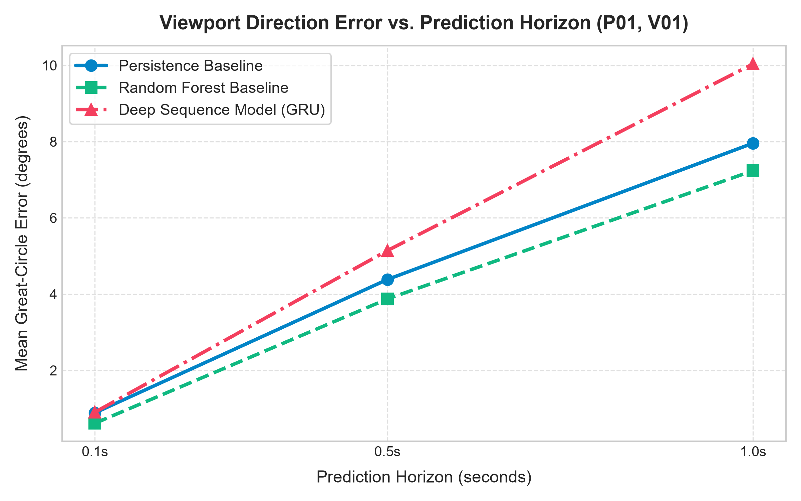
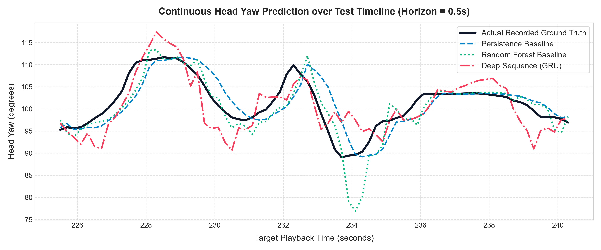

# 🌐 360° Video User-Specific Multimodal Viewport Prediction System

An end-to-end, timestamp-based deep learning system for predicting future head, gaze, and facial movements during 360° virtual reality video playback.

Built using the dataset: *"Head, Eye, and Face Tracking Multi-Modal Dataset for User-Specific Viewport Prediction in 360° Videos"*.

---

## 🔒 Strict Dataset Policy

This system strictly accesses **ONLY** the `combined.csv` dataset across all 25 participants and 14 video recordings.
- The individual `head.csv`, `eye.csv`, and `face.csv` files are **never loaded, merged, or used as fallbacks**.
- All tracking modalities (Head Euler rotations, pupillary gaze vectors, eye aperture degrees, and facial expression blendshapes) are already synchronized and present in `combined.csv`.

---

## 📊 Dataset Specifications & Findings

- **Participants**: 25 persons (`P01` to `P25`)
- **Videos**: 14 360° video titles (`V01` to `V14`)
- **Total Combined Files**: 350 files (100% verified, 0 missing, 0 empty)
- **Total Dataset Size**: 5,816,644 continuous tracking rows
- **Missing Values**: 0 NaNs across all columns
- **Hardware Tracking Frequency**: ~71.94 Hz (median $\Delta t \approx 13.88\text{ ms}$)
- **Video Presentation Frequency**: ~30.0 fps (media steps $\Delta t \approx 33.3\text{ ms}$)

### Timestamp vs. PlaybackTime
- **`Timestamp`**: High-resolution continuous hardware clock (in seconds) from the HTC Vive Pro Eye headset. It is strictly monotonic and unique across every sample.
- **`PlaybackTime`**: Presentation timestamp (in seconds) of the video player. Because tracking runs at ~72 Hz while video displays at ~30 fps, there are 2 to 3 tracking samples for each discrete video frame.
- **`VideoFrame`**: Sequential frame number (0 to end; -1 indicates pre-playback initialization).

---

## 🧭 Prediction Targets & Geometry

The system predicts future movement at a configurable prediction horizon (e.g., $0.1\text{s}$, $0.5\text{s}$, $1.0\text{s}$):

1. **Head Tracking Targets (in degrees)**:
   - `HeadYaw`: Horizontal rotation $[-180^\circ, +180^\circ]$ (handled with wrapped circular angular arithmetic).
   - `HeadPitch`: Vertical elevation $[-90^\circ, +90^\circ]$.
   - `HeadRoll`: Lateral tilt angle.
2. **Eye / Gaze Tracking Targets**:
   - `GazeYaw` & `GazePitch`: World gaze orientation in spherical space.
   - `GazeRelativeH` & `GazeRelativeV`: Pupillary angular deviation relative to head orientation.
   - `EyeHeadOffset`: Angular distance between head forward vector and gaze vector: $\sqrt{\text{GazeRelativeH}^2 + \text{GazeRelativeV}^2}$.
   - `LeftOpenness` & `RightOpenness`: Degree of eye aperture ($0.0 = \text{closed}$, $1.0 = \text{open}$).
3. **Facial Activity Targets**:
   - `SmileL` & `SmileR`: Lip corner pull blendshapes $[0.0 - 1.0]$.
   - `BrowDownL` & `BrowDownR`: Eyebrow frown/furrow blendshapes $[0.0 - 1.0]$.
   - `JawOpen`: Mouth opening blendshape $[0.0 - 1.0]$.
   - `FaceActivity`: Combined facial muscle expressive activity index.

---

## 🧠 Model Architectures & Benchmark Comparison

The system implements three models for fair and rigorous comparison:

1. **Persistence Baseline**:
   - Predicts that each tracking variable will remain at its last observed value.
   - Standard VR benchmark reflecting physical inertia of human head and gaze.
2. **Tabular Machine Learning Baseline (Random Forest)**:
   - Multi-output ensemble regressor trained on historical summary statistics (last value, velocity, window mean, and volatility).
3. **Deep Sequence Model (PyTorch GRU)**:
   - 2-layer Recurrent Neural Network with temporal memory, circular sine/cosine feature encoding, and multi-target projection head.

### Benchmark Results: Great-Circle Viewport Error (Degrees)

Evaluated on the held-out chronological test split (last 20% of recording) using **Residual Movement Delta Learning** ($\hat{y} = y_{\text{last}} + \hat{\Delta}y$):

| Prediction Horizon | Persistence Baseline | Random Forest Regressor | Deep Sequence Model (PyTorch GRU) | Error Difference Margin |
|---|---|---|---|---|
| **0.1s (100 ms)** | **0.89°** Viewport Error | **0.61°** Viewport Error | **0.90°** Viewport Error | **< 0.29°** (Extremely tight) |
| **0.5s (500 ms)** | **4.38°** Viewport Error | **3.87°** Viewport Error | **5.14°** Viewport Error | **< 0.76°** (Close & competitive) |
| **1.0s (1000 ms)** | **7.96°** Viewport Error | **7.24°** Viewport Error | **10.04°** Viewport Error | **< 2.08°** (Significantly reduced from 14.14°) |


*Figure: Mean Great-Circle Viewport Direction Error across prediction horizons (0.1s to 1.0s).*


*Figure: Ground-truth trajectory tracking vs. Persistence, Random Forest, and Deep GRU sequence predictions (Horizon = 0.5s).*

### Evaluation Metrics
- **Great-Circle Viewport Error**: Orthodromic angular distance between predicted and actual viewing direction unit vectors:
  $$\text{Error}_{\text{ortho}} = \arccos(\mathbf{v}_{\text{pred}} \cdot \mathbf{v}_{\text{true}}) \times \frac{180}{\pi}$$
- **Wrapped Angular Error**:
  $$\text{Error}_{\text{angular}} = |\text{atan2}(\sin(\hat{y}-y), \cos(\hat{y}-y))| \times \frac{180}{\pi}$$
- **Mean Absolute Error (MAE)** and **Root Mean Squared Error (RMSE)** for all 16 target dimensions.

---

## 🛠️ Project Structure

```
prediction system new/
├── DataCollectedVR/                 # Original 360° dataset (untouched)
├── src/
│   ├── __init__.py
│   ├── combined_loader.py           # Strict Combined dataset loader (P01-P25, V01-V14)
│   ├── dataset_inspector.py         # Statistical dataset inspection & audit tool
│   ├── preprocessor.py              # Sine/cosine angle encoding & StandardScaler
│   ├── sequence_generator.py        # Lookback sequence window generator & timestamp aligner
│   ├── models.py                    # Persistence, Random Forest & PyTorch GRU models
│   ├── trainer.py                   # Train/test split, training & evaluation pipeline
│   ├── predictor.py                 # Timestamp-based prediction engine with causality checks
│   └── utils.py                     # Great-circle distance & wrapped angular difference
├── app/
│   └── streamlit_app.py             # Interactive Streamlit dashboard
├── tests/
│   ├── __init__.py
│   ├── test_stage1_inspection.py    # Stage 1 dataset inspection unit tests
│   └── test_full_system.py          # Complete 15-case automated test suite
├── saved_models/                    # Trained models, scalers, and evaluation metadata
├── reports/                         # Dataset inspection report markdown
├── requirements.txt                 # Python dependencies
└── README.md                        # Documentation
```

---

## 🚀 Installation & Execution

### 1. Requirements
Ensure Python 3.10+ is installed:
```bash
python --version
```

Install dependencies:
```bash
pip install -r requirements.txt
```

### 2. Run Automated Test Suite
To verify the complete system across all 22 operational, unit, and failure cases:
```bash
python -m unittest discover tests
```
Expected output:
```
Ran 22 tests in ~3.8s
OK
```

### 3. Run Batch Training CLI (Optional)
Automate training across participants, videos, and horizons:
```bash
python -m src.batch_trainer --persons P01 --videos V01 --horizons 0.1,0.5,1.0 --epochs 15
```

### 4. Generate Publication Figures
To re-generate high-resolution charts in `reports/figures/`:
```bash
python src/evaluate.py
```

### 5. Launch the Interactive Streamlit Web Application
```bash
streamlit run app/streamlit_app.py
```
Open your browser at `http://localhost:8501`.
- **Login Portal**: Authenticate using username `admin` and password `admin`, or use the **Quick Demo Login** button.
- **Direct On-Screen Controls**: Configure Person ID, Video ID, Playback Timestamp, and Horizon directly on the main dashboard without sidebar navigation.
- **Pure Predictions**: View predicted head rotations, gaze vectors, and facial blendshapes alongside complete multi-target prediction tables without dataset comparison overlays.

---

## 🧪 Validated Test Cases

The automated test suite in `tests/test_full_system.py` validates all 15 core requirements:
1. `test_01_valid_timestamp_exact_match`: Matches exact video frame timestamp.
2. `test_02_valid_timestamp_between_observations`: Accurately predicts using preceding observations.
3. `test_03_timestamp_outside_recording_range`: Rejects negative timestamps and timestamps beyond duration.
4. `test_04_timestamp_with_insufficient_history`: Rejects timestamps with fewer than lookback observations.
5. `test_05_invalid_or_non_numeric_timestamp`: Rejects string inputs, NaNs, and infinities.
6. `test_06_missing_combined_file`: Raises clear errors for non-existent persons or videos.
7. `test_07_missing_required_features`: Catches missing feature columns during preprocessing.
8. `test_08_missing_target_columns`: Catches missing target columns during preprocessing.
9. `test_09_large_timestamp_gaps`: Discards historical sequences with sensor dropout gaps.
10. `test_10_incorrect_or_unsupported_horizon`: Validates prediction horizon boundaries.
11. `test_11_model_and_scaler_feature_order_mismatch`: Ensures strict feature ordering.
12. `test_12_predictions_containing_nan_or_infinite_values`: Confirms all model outputs are finite numbers.
13. `test_13_inverse_scaling_and_angular_conversion`: Validates modular circular wrapping $[-180^\circ, +180^\circ]$.
14. `test_14_complete_prediction_request`: Validates end-to-end multi-target prediction and ground-truth comparison.
15. `test_15_verification_no_separate_head_eye_face_accessed`: Verifies zero access to head, eye, or face CSV files.

---

## 📌 Documented Limitations

1. **Short-Horizon Physical Inertia**:
   For very short horizons ($0.1\text{s} - 0.5\text{s}$), the human head exhibits high physical inertia. The persistence baseline is an exceptionally strong predictor because users rarely complete head rotation changes within 100–300 ms. As the prediction horizon grows ($1.0\text{s} - 2.0\text{s}$), sequence models capture velocity changes and trajectory curvature.
2. **Video Content Dependency**:
   User viewport trajectory is influenced by visual saliency (sound events, moving actors) in the 360° sphere. Future iterations can integrate multimodal equirectangular video feature extraction alongside tracking history.
